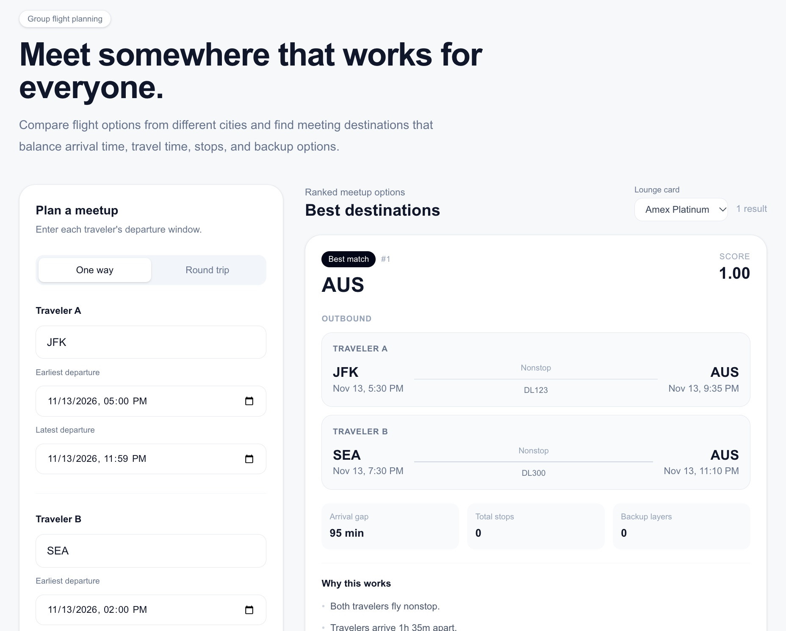
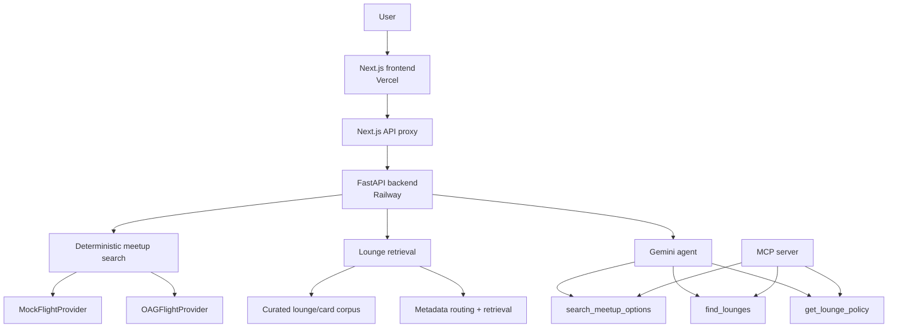

# Flight Meetup

Flight Meetup is a full-stack travel optimizer that answers a different question from a normal flight search:

> **If two people are leaving from different cities, where should they meet?**

Given two origins, departure/return windows, travel constraints, and ranking preferences, the app builds feasible itineraries, finds shared destinations, ranks them for group convenience, explains the recommendation, and can surface grounded airport-lounge information for supported credit cards.

The project combines a deterministic flight-search engine with FastAPI, Next.js, provider abstractions, RAG, LangChain tools, Gemini tool calling, and MCP.

## Demo

**Frontend:** https://frontend-five-brown-e05gyzilwo.vercel.app/  
**Backend:** deployed on Railway  
**Backend API docs:** https://flightmeetup-production.up.railway.app/docs



> The public deployment currently uses the local mock flight provider so visitors cannot exhaust the project's limited OAG API quota. The same backend also supports live OAG schedule retrieval when `FLIGHT_PROVIDER` is switched from `mock` and an `OAG_API_KEY` is configured.

### Demo scenario

A known working round-trip example is:

- Traveler A: **JFK**, Nov. 13, 2026, 5:00 PM–11:59 PM
- Traveler B: **SEA**, Nov. 13, 2026, 2:00 PM–8:00 PM
- Return: Nov. 15, 2026
- Maximum arrival gap: 120 minutes
- Maximum stops: 1

The app recommends **Austin (AUS)** with:

- JFK → AUS: Delta DL123
- SEA → AUS: Delta DL300
- AUS → JFK: Delta DL501
- AUS → SEA: Delta DL502

For **Amex Platinum**, the AUS result can also surface the Delta Sky Club location and grounded access-policy evidence.

## What it demonstrates

- Multi-origin destination search instead of single-origin flight search
- Direct and bounded one-stop itinerary construction
- Timezone-aware outbound and return-window handling
- Explainable ranking across arrival synchronization, stops, travel time, and backup options
- User-tunable ranking preferences
- Round-trip feasibility with actual return itineraries
- Provider abstraction for local mock data and live OAG schedules
- API-quota protections for external flight data
- Grounded lounge/card retrieval from curated official-source data
- LangChain tool wrappers and Gemini multi-step tool calling
- MCP exposure of the same backend capabilities
- Next.js frontend with FastAPI backend
- Automated backend tests, frontend production builds, and Docker image builds in GitHub Actions
- Production deployment with Vercel + Railway

## Architecture



A core design rule is that the LLM does **not** calculate flight feasibility, connection timing, or ranking. Those remain deterministic Python responsibilities. The model decides which tools to call and turns structured tool results into a user-facing response.

## Product flow

1. Enter two traveler origins and departure windows.
2. Choose one-way or round-trip.
3. Set hard constraints such as maximum stops and arrival gap.
4. Adjust ranking preferences.
5. Search for shared destinations.
6. Review ranked itinerary pairs, raw metrics, and explanations.
7. Optionally choose a supported credit card and check lounge access at a recommended destination.

## Flight search and ranking

The deterministic flight engine:

1. Collects schedules for each traveler.
2. Builds direct and bounded one-stop itineraries.
3. Enforces a 45-minute minimum connection and 4-hour maximum layover.
4. Finds common meeting destinations.
5. Applies hard constraints such as maximum stops, travel time, and arrival gap.
6. Checks return feasibility for round-trip searches.
7. Scores feasible itinerary pairs.
8. Ranks destinations while retaining raw metrics for explainability.

The OAG provider is isolated behind a `FlightProvider` interface, so routing and ranking do not depend on HTTP.

Live-provider safeguards include:

- Process-local TTL caching shared across API requests
- Configurable request budgets
- Bounded retries
- 429 / `Retry-After` handling
- Pagination controls
- Query deduplication
- Tests that avoid accidental live OAG calls

## Lounge intelligence

The lounge subsystem intentionally focuses on a narrow, grounded question: **which lounges match a supported card at a specific airport, and what source-backed policy evidence applies?**

The corpus stores structured metadata such as:

- card
- airport
- lounge network
- document type
- source
- retrieval date

Current curated location coverage includes airports such as **JFK, MIA, AUS, ATL, SEA, and LAX**, with supported card-policy data including **Amex Platinum** and **Delta Reserve**.

The retrieval pipeline is:

```text
official source pages
        ↓
cleaned / structured content
        ↓
chunked policy + lounge-location documents
        ↓
metadata routing by card / airport / lounge network
        ↓
retrieval
        ↓
grounded policy evidence
```

The frontend exposes this through a simple card selector and per-destination **Check lounges** action.

### Retrieval evaluation

The project includes BM25, dense, and hybrid retrieval experiments.

On the initial 11-query development set:

| Retriever | Hit@1 | Hit@3 | MRR |
| --- | ---: | ---: | ---: |
| BM25 | 0.455 | 0.545 | 0.558 |
| Dense | 0.455 | **1.000** | 0.727 |
| Equal-weight hybrid RRF | **0.636** | 0.818 | **0.738** |

After metadata routing by card / lounge network, the product evaluation reached **15/15 at k=3** on the current development set.

These are development-set results, not production benchmarks.

## Tool calling

The reusable agent exposes three LangChain tools:

- `search_meetup_options` — find and rank shared meeting destinations
- `find_lounges` — find physical lounges at an airport that match a card's lounge networks
- `get_lounge_policy` — retrieve grounded access-policy evidence for a card + lounge network

A typical agent flow is:

```text
user request
   ↓
search_meetup_options
   ↓
ranked meeting destination
   ↓
find_lounges
   ↓
matching lounge networks + locations
   ↓
get_lounge_policy
   ↓
grounded final response
```

Tool wrappers stay thin; the business and retrieval logic remains reusable outside the LLM layer.

## MCP

The same three capabilities are exposed through an MCP server:

```text
search_meetup_options
find_lounges
get_lounge_policy
```

This keeps MCP as a transport/interface layer rather than duplicating application logic. The server has also been tested interactively with MCP Inspector.

## Repository structure

```text
backend/
  app/
    agent/          # Gemini tool-calling loop
    airports/       # airport timezone utilities
    domain/         # core Pydantic models
    providers/      # mock + OAG provider adapters
    rag/            # lounge retrieval logic
    ranking/        # scoring and ranking
    routing/        # itinerary construction / reachability
    tools/          # LangChain tool wrappers
    api.py          # FastAPI endpoints
    observability.py # structured search telemetry
    mcp_server.py   # MCP adapter

frontend/
  app/
    api/            # Next.js proxy routes
    page.tsx        # search + results UI

data/
  rag/              # lounge/card corpus, chunks, evaluation data

scripts/
  ingest_rag.py
  chunk_rag.py
  retrieve_bm25.py
  retrieve_dense.py
  retrieve_hybrid.py
  evaluate_retrieval.py
  evaluate_product_retrieval.py
  evaluate_ranking.py
  evaluate_oag.py
  benchmark_latency.py
  demo_tool_calling.py
  search_real_meetup.py

tests/
  # deterministic unit/integration tests
```

## Engineering evaluation and benchmarking

### Ranking evaluation

The repository includes a curated ranking-evaluation suite covering individual objectives and deliberate tradeoffs between arrival synchronization, stops, travel time, and backup flexibility.

Run:

```bash
python -m scripts.evaluate_ranking
```

The current 12-scenario suite verifies that changing ranking weights changes the preferred destination in the expected direction. The current evaluation passes **12/12 expected outcomes (100%)**. Treat this as a deterministic product-behavior evaluation set, not a real-world user-preference benchmark.

### Controlled live OAG evaluation

A separate opt-in harness evaluates the real OAG-backed direct-search path without turning the repository's normal tests into live API calls.

The default scenario set uses three origin pairs and measures:

- cold OAG HTTP request count
- cold end-to-end search latency
- flights collected
- number of common destinations
- top-ranked destinations
- identical-repeat cache behavior
- additional OAG requests after cache warm-up

Run one scenario first:

```bash
RUN_LIVE_OAG_EVAL=1 python -m scripts.evaluate_oag \
  --date 2026-11-13 \
  --max-scenarios 1 \
  --request-budget 25
```

Then, if the first run looks reasonable, run all three:

```bash
RUN_LIVE_OAG_EVAL=1 python -m scripts.evaluate_oag \
  --date 2026-11-13 \
  --max-scenarios 3 \
  --request-budget 25 \
  --output data/oag_eval_results.json
```

The script is disabled unless `RUN_LIVE_OAG_EVAL=1` and an `OAG_API_KEY` are both set. It is intentionally direct-only and one-way to keep provider fan-out bounded.

In the current controlled three-scenario evaluation:

- **3/3** origin-pair scenarios produced at least one feasible common destination
- **396** live flight records were processed
- **55** cold OAG HTTP requests were used across the three scenarios
- identical repeated searches required **0 additional OAG calls** after warm-up in all three scenarios

These results are a small engineering evaluation, not a broad production benchmark. The OAG cache is process-local: it persists across API requests handled by the same backend process, but resets on restart and is not shared across multiple instances.

### Latency benchmark

Run a quota-safe local benchmark of the full FastAPI `POST /meetups/search` path using the mock provider:

```bash
python -m scripts.benchmark_latency
```

The script reports mean, median, p95, minimum, and maximum latency.

On a 100-request localhost HTTP benchmark using the mock provider, the current search path measured approximately **0.62 ms median** and **0.74 ms p95**. This is a local deterministic-path benchmark and does not include OAG network or pagination latency.

To measure a deployed backend instead:

```bash
python -m scripts.benchmark_latency --url https://YOUR-BACKEND
```

Do not point repeated remote benchmarks at a live OAG-backed deployment unless you intentionally want to consume provider quota.

### Docker

Build and run the FastAPI backend locally:

```bash
docker build -t flight-meetup .
docker run --rm -p 8000:8000 -e FLIGHT_PROVIDER=mock flight-meetup
```

Then open:

```text
http://localhost:8000/docs
```

## Local development

### 1. Clone the repository

```bash
git clone https://github.com/beverlyqin/flight_meetup.git
cd flight_meetup
```

### 2. Set up the Python backend

```bash
python -m venv .venv
source .venv/bin/activate
pip install -r requirements.txt
```

The project is currently developed with Python 3.13.

Run the backend in quota-safe mock mode:

```bash
FLIGHT_PROVIDER=mock uvicorn backend.app.api:app --reload
```

FastAPI docs will be available at:

```text
http://127.0.0.1:8000/docs
```

### 3. Run the frontend

In a second terminal:

```bash
cd frontend
npm install
npm run dev
```

Open:

```text
http://localhost:3000
```

The frontend's Next.js API routes proxy requests to the FastAPI backend.

### 4. Run tests

From the repository root:

```bash
python -m pytest
```

For the frontend:

```bash
cd frontend
npm run build
```

### 5. Use live OAG schedules

Set:

```bash
export OAG_API_KEY="your-key"
unset FLIGHT_PROVIDER
```

Then start FastAPI normally:

```bash
uvicorn backend.app.api:app --reload
```

Because OAG usage is quota-limited, routine development and automated tests should use the mock provider.

### 6. Run the Gemini agent

Set a Gemini Developer API key:

```bash
export GOOGLE_API_KEY="your-key"
```

Then:

```bash
python -m scripts.demo_tool_calling
```

The Google Gen AI client also supports `GEMINI_API_KEY`; set only one key variable when possible.

### 7. Inspect the MCP server

From the repository root:

```bash
PYTHONPATH=. mcp dev backend/app/mcp_server.py
```

Connect with MCP Inspector to inspect and call the tools.

## API

### Meetup search

```text
POST /meetups/search
```

Returns ranked meetup destinations, outbound itineraries, optional return itineraries, ranking metrics, component scores, backup counts, and deterministic explanations.

### Lounge cards

```text
GET /lounges/cards
```

Returns cards currently represented in the lounge-policy corpus.

### Lounge search

```text
POST /lounges/search
```

Returns matching physical lounges and grounded access-policy evidence for a card + airport.

### Agent

```text
POST /agent/meetup
```

Runs the Gemini tool-calling loop over the reusable search and lounge tools.

## Deployment

The production architecture currently uses two services:

```text
Vercel
  Next.js frontend
       ↓ BACKEND_URL
Railway
  FastAPI backend
```

### Backend — Railway

Start command:

```bash
uvicorn backend.app.api:app --host 0.0.0.0 --port $PORT
```

Public demo environment:

```text
FLIGHT_PROVIDER=mock
```

Backend API:

https://flightmeetup-production.up.railway.app

### Frontend — Vercel

Public demo: https://frontend-five-brown-e05gyzilwo.vercel.app/

The frontend project uses `frontend/` as its root directory.

Environment variable:

```text
BACKEND_URL=https://flightmeetup-production.up.railway.app
```

Using a server-side Next.js proxy keeps backend configuration out of the browser-facing request path.

## Design decisions

### Deterministic computation first

Flight times, connection feasibility, itinerary construction, return feasibility, and ranking stay outside the LLM. This keeps the core system testable and prevents the model from inventing flight facts.

### Provider abstraction

The flight engine consumes normalized `FlightSegment` objects through `FlightProvider`, allowing mock and live providers to share the same search/ranking pipeline.

### Quota is a system-design constraint

OAG's limited request budget shaped caching, query planning, deduplication, bounded connection expansion, and the decision to keep the public portfolio deployment in mock mode.

### Metadata before semantic similarity

Lounge retrieval first narrows the search space using structured metadata such as card, airport, and lounge network before retrieving supporting policy evidence.

### Thin AI interfaces

LangChain tools and MCP functions wrap stable backend functions rather than owning business logic. The same flight/RAG logic can therefore be reused by FastAPI, the web UI, an agent, tests, or external MCP clients.

## Current limitations

- Two-traveler search is the primary product path.
- Flight-data scope is currently Delta-centric.
- The public deployment uses fixture schedules rather than unrestricted live OAG calls.
- Lounge coverage is curated rather than a complete airport database.
- Supported card coverage is intentionally small.
- Ranking behavior is only as rich as the candidate destinations returned by the underlying schedule data.
- Final agent wording still requires grounding guardrails for subtle policy language.

## Next steps

- Reduce cold live-provider latency by cutting unnecessary pagination and parallelizing independent provider requests where appropriate
- Expand the demo fixture to show more ranking tradeoffs across multiple shared destinations
- Consider a distributed cache if the backend scales beyond a single process
- Expand lounge/card coverage selectively
- Record a short portfolio demo

## Why this project

Flight Meetup separates concerns deliberately:

- deterministic algorithms decide what is feasible,
- ranking decides what is convenient,
- retrieval supplies grounded travel knowledge,
- the LLM orchestrates those capabilities,
- MCP makes the same capabilities reusable by external AI clients,
- the web app turns those layers into a usable product.

That separation is the core engineering of the project.
