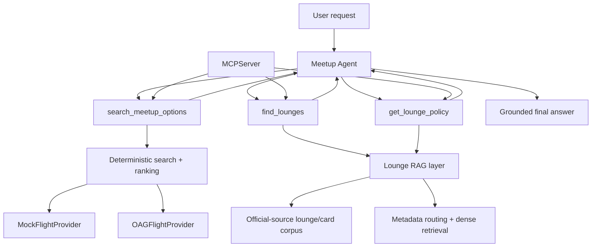

# Flight Meetup

Flight Meetup is a backend-first travel optimizer that finds **where two travelers should meet** instead of requiring them to choose a destination first.

Given two origins, departure windows, and travel constraints, the system collects flight schedules, builds feasible direct and one-stop itineraries, finds shared destinations, ranks them with explainable metrics, and enriches the result with grounded airport-lounge information.

The current prototype is Delta-centric and combines deterministic flight computation with RAG, LangChain tool calling, and MCP.

## What it demonstrates

- Multi-traveler destination search rather than single-origin flight search
- Deterministic direct + one-stop itinerary construction
- Explainable ranking using arrival synchronization, stops, travel time, and backup options
- Provider abstraction with local mock data and live OAG schedule retrieval
- Timezone-aware connection planning with DST-safe airport timezones
- API-quota protections for live schedule providers
- Official-source lounge RAG with retrieval evaluation
- LangChain tools and multi-step Gemini tool calling
- MCP exposure of the same stable backend capabilities
- 64 automated tests

## Example

The deterministic agent demo currently includes a fixture where:

- Traveler A leaves **JFK** between 5 PM and midnight Eastern
- Traveler B leaves **SEA** between 2 PM and 8 PM Pacific
- Maximum arrival gap is 2 hours
- Maximum stops is 1

The system recommends **Austin (AUS)**:

- JFK → AUS: Delta DL123, nonstop
- SEA → AUS: Delta DL300, nonstop
- Arrival gap: **95 minutes**

For an Amex Platinum traveler departing JFK, the agent can then discover matching physical lounges and retrieve the relevant access-policy evidence before generating an answer.

> The agent demo intentionally uses the local mock flight provider so repeated LLM/tool tests do not consume OAG API quota. Live OAG-backed search is implemented separately through the provider/API layer.

## Architecture



### Layering

```text
backend/app/domain + routing + ranking
        ↓
deterministic flight engine

backend/app/providers
        ↓
Mock / OAG schedule sources

backend/app/rag
        ↓
retrieval and lounge-policy logic

backend/app/tools
        ↓
thin LangChain-facing wrappers

backend/app/agent
        ↓
Gemini tool orchestration

backend/app/mcp_server.py
        ↓
same capabilities exposed through MCP
```

A core design rule is that the LLM does **not** calculate flight feasibility, connection timing, or ranking. Those remain deterministic Python responsibilities. The model decides which tools to call and turns structured tool results into a user-facing response.

## Flight search and ranking

The flight engine:

1. Collects schedules for each traveler.
2. Builds direct and bounded one-stop itineraries.
3. Enforces a 45-minute minimum connection and 4-hour maximum layover.
4. Finds common meeting destinations.
5. Applies hard constraints such as maximum stops, travel time, and arrival gap.
6. Scores feasible itinerary pairs.
7. Ranks destinations while retaining raw metrics for explainability.

The OAG provider is isolated behind a `FlightProvider` interface, so routing and ranking do not depend on HTTP.

Live-provider safeguards include:

- Exact-query in-memory caching
- Configurable request budgets
- Bounded retries
- 429 / `Retry-After` handling
- Pagination controls
- Query deduplication
- Normal pytest blocking of accidental live OAG calls

## Lounge RAG

The RAG subsystem is intentionally narrow: it handles airport lounge locations and credit-card lounge-access policy rather than general airline policy.

Pipeline:

```text
official source pages
        ↓
semantic extraction
        ↓
structured Markdown
        ↓
sentence-aware tokenizer-safe chunks
        ↓
metadata: card / airport / lounge network / source
        ↓
BM25 / dense / hybrid experiments
        ↓
metadata-routed dense retrieval
        ↓
policy evidence returned to the agent
```

Current corpus work includes Amex Platinum lounge policy, Delta Reserve/Centurion policy, JFK lounge locations, and MIA Centurion location data.

### Retrieval evaluation

On the initial 11-query development set:

| Retriever | Hit@1 | Hit@3 | MRR |
| --- | ---: | ---: | ---: |
| BM25 | 0.455 | 0.545 | 0.558 |
| Dense | 0.455 | **1.000** | 0.727 |
| Equal-weight hybrid RRF | **0.636** | 0.818 | **0.738** |

Dense retrieval was selected for top-k context retrieval because it gave the strongest top-3 recall. After adding metadata routing by card / lounge network, the current 15-query product evaluation reached **15/15 at k=3**.

These are development-set results, not production benchmarks.

## Tool calling

The reusable agent exposes three LangChain tools:

- `search_meetup_options` — find and rank shared meeting destinations
- `find_lounges` — find physical lounges at an airport that match a card's lounge networks
- `get_lounge_policy` — retrieve grounded access-policy evidence for a card + lounge network

A typical agent flow is:

```text
user request
   ↓
search_meetup_options
   ↓
ranked meeting destination
   ↓
find_lounges
   ↓
matching lounge networks + locations
   ↓
get_lounge_policy
   ↓
grounded final response
```

Tool wrappers stay thin; the business and retrieval logic remains reusable outside the LLM layer.

## MCP

The same three capabilities are also exposed through an MCP server:

```text
search_meetup_options
find_lounges
get_lounge_policy
```

This keeps MCP as a transport/interface layer rather than duplicating application logic.

The server has been verified interactively with MCP Inspector.

## Repository structure

```text
backend/
  app/
    agent/          # reusable Gemini tool-calling loop
    airports/       # airport timezone utilities
    domain/         # core Pydantic models
    providers/      # mock + OAG provider adapters
    rag/            # lounge retrieval logic
    ranking/        # scoring and ranking
    routing/        # itinerary construction / reachability
    tools/          # LangChain tool wrappers
    api.py          # FastAPI endpoint
    mcp_server.py   # MCP adapter

data/
  rag/              # source registry, cleaned docs, chunks, eval sets

scripts/
  ingest_rag.py
  chunk_rag.py
  retrieve_bm25.py
  retrieve_dense.py
  retrieve_hybrid.py
  evaluate_retrieval.py
  evaluate_product_retrieval.py
  demo_tool_calling.py
  search_real_meetup.py

tests/
  # deterministic unit/integration tests; live OAG is blocked by default
```

## Quick start

### 1. Clone and create an environment

```bash
git clone https://github.com/beverlyqin/flight_meetup.git
cd flight_meetup

python -m venv .venv
source .venv/bin/activate
pip install -r requirements.txt
```

The project is currently developed with Python 3.13.

### 2. Run the test suite

```bash
python -m pytest
```

Current status: **64 passing tests**.

### 3. Run the deterministic agent demo

Set a Gemini Developer API key:

```bash
export GOOGLE_API_KEY="your-key"
```

Then:

```bash
python -m scripts.demo_tool_calling
```

The Google Gen AI client also supports `GEMINI_API_KEY`; set only one key variable when possible.

### 4. Run live OAG-backed API search

Set the OAG key:

```bash
export OAG_API_KEY="your-key"
```

Start FastAPI:

```bash
uvicorn backend.app.api:app --reload
```

The live deterministic endpoint is:

```text
POST /meetups/search
```

The agent endpoint is:

```text
POST /agent/meetup
```

with a JSON body such as:

```json
{
  "question": "Find a meetup destination for JFK and SEA and tell me about JFK lounges."
}
```

The agent endpoint uses the reusable Gemini tool-calling loop. Because OAG usage is quota-limited, normal development and tests should use mock/fake providers.

### 5. Inspect the MCP server

Install `uv` if needed, then from the repository root:

```bash
PYTHONPATH=. mcp dev backend/app/mcp_server.py
```

Connect in MCP Inspector and inspect/call the three tools.

## Design decisions

### Deterministic computation first

Flight times, connection feasibility, itinerary construction, and ranking stay outside the LLM. This makes the core system testable and prevents the model from inventing flight facts.

### Provider abstraction

The flight engine consumes normalized `FlightSegment` objects through `FlightProvider`, allowing mock and live providers to share the same search/ranking pipeline.

### Quota is a system-design constraint

OAG's limited request budget shaped caching, query planning, deduplication, bounded connection expansion, and the decision to keep normal tests offline.

### Metadata before semantic similarity

Lounge retrieval first narrows by structured metadata such as card, airport, and lounge network. Dense retrieval then operates only on the relevant policy subset.

### Thin AI interfaces

LangChain tools and MCP functions wrap stable backend functions rather than owning business logic. The same flight/RAG logic can therefore be reused by FastAPI, an agent, tests, or external MCP clients.

## Current limitations

- Two-traveler flow is the primary supported product path.
- Flight-data scope is Delta-centric.
- The agent's flight-search tool currently uses the mock provider by design.
- Live OAG integration exists but is intentionally separated from repeated LLM testing.
- Lounge coverage is still a small curated corpus rather than a complete airport database.
- Final LLM wording can still require grounding/fidelity guardrails for subtle policy language.
- Web UI, deployment, CI, and production observability are not finished.

## Next steps

- Build the web-first UI for traveler inputs and ranked destination cards
- Add CI, Docker, and deployment
- Expand ranking-evaluation scenarios and choose initial default weights
- Expand lounge/card/airport coverage
- Add production logging and latency/request monitoring
- Capture screenshots and a 60–90 second portfolio demo

## Why this project

The interesting part is not simply calling a flight API or adding an LLM. Flight Meetup separates concerns deliberately:

- deterministic algorithms decide what is feasible,
- ranking decides what is convenient,
- retrieval supplies grounded travel knowledge,
- the LLM orchestrates those capabilities,
- MCP makes the same capabilities reusable by external AI clients.

That separation is the core engineering story of the project.
